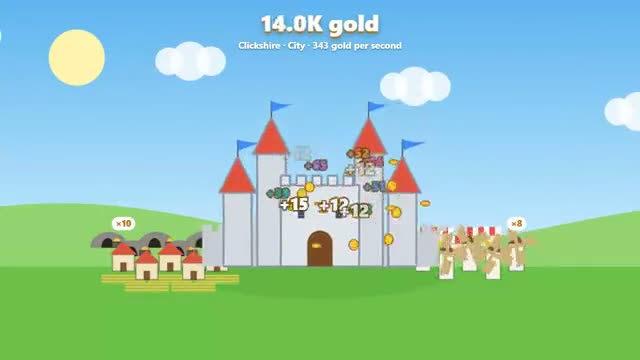

# Clicker Kingdom

Everyone grows one kingdom together. A multiplayer starter game from [Multiplayer Agent](https://multiplayeragent.com): 2D, drop-in, 2–30 players, with bot helpers that fill empty seats.

## How it plays

Every click adds gold to one shared kingdom. Spend it on farms, windmills and mines that keep earning, and on upgrades that make every click worth more.

**Controls:** Click or tap the kingdom, then tap the shop to build.

## Make it yours in the Game Builder

Open the [Game Builder](https://multiplayeragent.com), choose **Start from a starter game** and pick Clicker Kingdom. It opens as version 1 in your studio, ready to play and publish. Then ask for changes, for example:

- Add a boss everyone clicks down together
- Add rival kingdoms
- Add a reset that gives a permanent bonus

## Run it yourself

1. Get a free publishable key (`pk_…`) at [multiplayeragent.com](https://multiplayeragent.com).
2. In `index.html`, put it in place of `pk_REPLACE_ME` in the `MP_CONNECT` block.
3. Open `index.html` in a browser. No build step and no server needed.

Without a key it still runs, offline with bot helpers, and remembers your kingdom in this browser.

## How it is built

- One `index.html`. The comment at the top of the script maps the code and explains the multiplayer.
- **World memory:** The kingdom is remembered by the players who built it. Every player saves a copy every 10 seconds and when they leave; whoever comes back first brings it back for everyone, and its buildings earn half their usual gold for the time it was empty (up to 8 hours).
- **Leaderboard:** The players who have given the kingdom the most gold, under the trophy button.
- **Host-run rules:** The host's browser counts every click (in batches, capped) and checks every purchase. If it leaves, the next player takes over.
- **Bots:** Bot helpers click and buy until enough people join.
- `?attract` runs it offline with bots only. The preview video is recorded from it.

## License

MIT.
